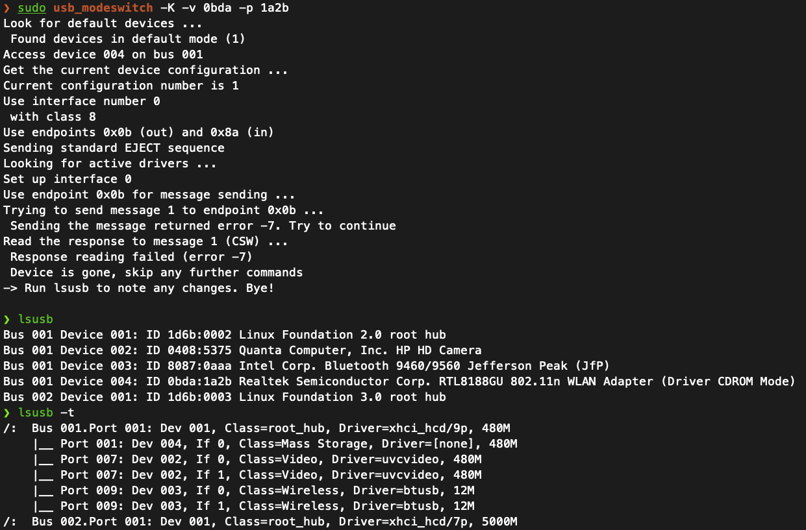
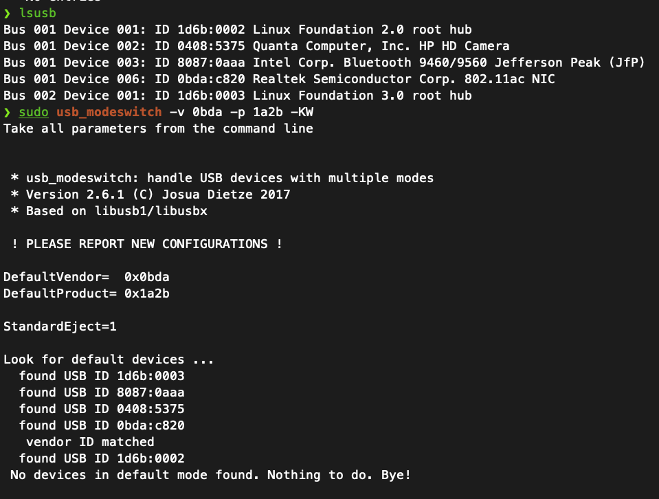

# RTL8821CU — Linux & macOS USB Wi-Fi Research

> A systems programming research project documenting Realtek USB device identification, USB mode switching, Linux kernel driver verification, and future cross-platform C/`libusb` development.

**Current stage:** Linux USB identification and wireless scanning verified. C development has not started.  
**Observed transition:** `0bda:1a2b` (virtual CD-ROM mode) → `0bda:c820` (802.11ac mode).  
**Verified:** Linux kernel driver binding and wireless scanning on 2.4 GHz and 5 GHz.  
**Not yet tested:** Connecting to a Wi-Fi network, transferring packets, Bluetooth functionality, or native macOS support.

> **Privacy notice:** This public version is intentionally sanitized. Hostnames, usernames, network names (SSIDs), network interface identifiers derived from MAC addresses, IP addresses, and raw scan data are excluded. Terminal excerpts are either limited to relevant lines or labeled *sanitized*. The adapter's USB VID:PID values and driver names are retained because they are needed to reproduce the hardware investigation.

## Contents

- [Project scope](#project-scope)
- [Tested hardware and environment](#tested-hardware-and-environment)
- [Phase 1 — Device identification](#phase-1--device-identification)
- [Phase 2 — USB mode switching](#phase-2--usb-mode-switching)
- [Phase 3 — Driver verification](#phase-3--driver-verification)
- [Phase 4 — Wireless scanning](#phase-4--wireless-scanning)
- [Reproducing the checks safely](#reproducing-the-checks-safely)
- [Development roadmap](#development-roadmap)
- [Privacy and evidence policy](#privacy-and-evidence-policy)
- [References](#references)

## Project scope

Some USB Wi-Fi adapters initially present themselves as a **virtual CD-ROM / mass-storage device** containing installation software. They must then re-enumerate under another USB product identifier before an operating system can use the wireless interface.

This repository tracks the investigation of a Realtek USB Wi-Fi adapter on Debian Linux. Planned work includes a portable, read-only USB inspector in **C / `libusb`**, analysis of the **Linux `rtw88` driver**, and research into constraints affecting **macOS** support.

This project **does not yet contain a custom Wi-Fi driver** or establish that native macOS Wi-Fi support is possible for this adapter.

## Tested hardware and environment

| Property | Observed result |
| --- | --- |
| Operating system | Debian Linux |
| Kernel family | Linux 6.12 series |
| USB vendor | Realtek (`0bda`) |
| Installation-mode USB ID | `0bda:1a2b` |
| Installation-mode description | `RTL8188GU 802.11n WLAN Adapter (Driver CDROM Mode)` |
| Operational-mode USB ID | `0bda:c820` |
| Operational-mode description | `802.11ac NIC` |
| Identified Linux driver | `rtw88_8821cu` (module) / `rtw_8821cu` (bound USB driver) |
| Wireless scan | Successful on 2.4 GHz and 5 GHz |
| USB mode-switching utility | `usb_modeswitch` 2.6.1 |

**Identification caveat:** The `RTL8188GU` label belongs to the initial USB ID description. The operational ID `0bda:c820` matches the Linux `rtw88_8821cu` device table and was verified against the running driver.

## Phase 1 — Device identification

### Why use `lsusb`?

```bash
lsusb
```

`lsusb` lists the USB devices recognized by Linux. Its **Vendor ID (VID)** and **Product ID (PID)** fields let us distinguish the adapter's installation mode from its operational mode.

**Initial relevant output:**

```text
Bus 001 Device 004: ID 0bda:1a2b Realtek Semiconductor Corp. RTL8188GU 802.11n WLAN Adapter (Driver CDROM Mode)
```

We also inspected the USB topology:

```bash
lsusb -t
```

**Relevant interface entry (excerpt):**

```text
If 0, Class=Mass Storage, Driver=[none], 480M
```

The kernel logs confirmed that the device presented itself as a storage unit:

```bash
sudo journalctl -k -b --no-pager
```

**Relevant excerpt:**

```text
New USB device found, idVendor=0bda, idProduct=1a2b
Product: DISK
Manufacturer: Realtek
USB Mass Storage device detected
```

### Figure 1 — Initial CD-ROM mode



*Figure 1. The first `usb_modeswitch` attempt and subsequent USB inspection. The adapter still appeared as `0bda:1a2b` / Mass Storage at that point.*

## Phase 2 — USB mode switching

The `usb-modeswitch` utility can trigger a device to stop presenting its installation interface and re-enumerate in its operational mode.

### Tools used

```bash
sudo apt update
sudo apt install usb-modeswitch usb-modeswitch-data iw
```

| Package | Purpose |
| --- | --- |
| `usb-modeswitch` | Send supported mode-switching commands to multi-mode USB devices |
| `usb-modeswitch-data` | Provide known device rules and configurations |
| `iw` | Inspect and scan Linux wireless interfaces |
| `kmod` | Supply kernel module tools including `modinfo` and `lsmod` |

The initial attempt was:

```bash
sudo usb_modeswitch -K -v 0bda -p 1a2b
```

| Flag | Purpose |
| --- | --- |
| `-K` | Send the standard mass-storage eject sequence |
| `-v 0bda` | Match the USB vendor ID |
| `-p 1a2b` | Match the USB product ID in installation mode |

**Observed output:**

```text
Sending standard EJECT sequence
Sending the message returned error -7. Try to continue
Response reading failed (error -7)
Device is gone, skip any further commands
```

In `libusb`, error `-7` indicates a **timeout**. A follow-up `lsusb` still showed `0bda:1a2b`, so this attempt alone **did not establish a successful mode switch**.

At a later observation, `lsusb` reported:

```text
Bus 001 Device 006: ID 0bda:c820 Realtek Semiconductor Corp. 802.11ac NIC
```

The exact event that caused this successful re-enumeration **was not isolated**, so the project does not attribute it conclusively to any particular command or reconnection.

A later diagnostic command:

```bash
sudo usb_modeswitch -v 0bda -p 1a2b -KW
```

returned:

```text
No devices in default mode found. Nothing to do. Bye!
```

This was expected because the adapter was **already** enumerated under `0bda:c820`. The `-W` flag requests verbose output; that command did not itself perform the observed successful transition.

### Figure 2 — Operational Wi-Fi mode



*Figure 2. `lsusb` shows the operational USB ID `0bda:c820`. The subsequent verbose mode-switch check finds no installation-mode device.*

## Phase 3 — Driver verification

### Confirm the module installed for this adapter

```bash
modinfo rtw88_8821cu
```

**Selected, sanitized module metadata:**

```text
license:        Dual BSD/GPL
description:    Realtek 802.11ac wireless 8821cu driver
alias:          usb:v0BDApC820d*dc*dsc*dp*icFFiscFFipFFin*
depends:        usbcore,rtw88_8821c,rtw88_usb
intree:         Y
name:           rtw88_8821cu
```

The module advertises compatibility with `0bda:c820`. `intree: Y` means it was built from the kernel tree.

### Verify the USB driver binding

```bash
lsusb -t
```

**Relevant lines only (other host devices omitted):**

```text
If 0, Class=Wireless, Driver=btusb, 480M
If 1, Class=Wireless, Driver=btusb, 480M
If 2, Class=Vendor Specific Class, Driver=rtw_8821cu, 480M
```

The adapter exposes Bluetooth USB interfaces (0 and 1) alongside its Wi-Fi interface (2). This confirms driver binding, **not** that Bluetooth pairing has been tested.

The associated network-device driver was also verified through Linux sysfs. The command used a local interface name that is intentionally omitted from the public record:

```bash
# Substitute the interface name found locally using: iw dev
readlink -f "/sys/class/net/${USB_WIFI_IFACE}/device/driver"
```

**Observed output:**

```text
/sys/bus/usb/drivers/rtw_8821cu
```

### Verify loaded kernel modules

```bash
lsmod | rg 'rtw88|rtw_'
```

**Relevant module names from the recorded output (host-specific counts omitted):**

```text
rtw88_8821cu
rtw88_8821c
rtw88_usb
rtw88_core
mac80211
cfg80211
usbcore
```

`rtw88_8821cu` identifies the USB adapter, `rtw88_usb` handles USB transport, and `rtw88_8821c` supplies chipset-specific support. The Linux wireless stack uses `mac80211` and `cfg80211`.

> `lsmod` reference counts are not an activity indicator. The binding was confirmed independently through `lsusb -t` and sysfs.

### Optional Figure 3 — Driver binding

This result is already documented above. If a screenshot is added, **capture only the adapter's interface lines and the final sysfs driver path**; crop out the rest of the USB hardware inventory, device name, prompts, and paths containing a MAC-derived interface name.

Suggested public filename: `docs/images/03-kernel-driver-binding.png`.

<!-- Add a Markdown image link here ONLY after creating and reviewing a sanitized screenshot. -->

## Phase 4 — Wireless scanning

Running `iw dev` confirmed the presence of both an internal Wi-Fi interface and a separate USB wireless interface in **managed** mode. Their actual names, MAC addresses, and associated SSID have been omitted intentionally.

We then used the **USB adapter only** to scan for nearby wireless networks:

```bash
# USB_WIFI_IFACE must be assigned locally, not committed to Git.
sudo iw dev "$USB_WIFI_IFACE" scan
```

**Selected terminal observations — sanitized (SSID and BSSID omitted):**

```text
freq: 2452.0
signal: -58.00 dBm
freq: 5805.0
signal: -60.00 dBm
freq: 2432.0
signal: -62.00 dBm
freq: 5200.0
signal: -55.00 dBm
```

The real scan returned results on **2.4 GHz and 5 GHz**, confirming the adapter's scanning / reception path. Frequencies and signal strengths are retained as technical measurements; network identifiers are not published.

**Verified:** receiving scan results. **Not verified:** association, authentication, DHCP, packet transfer, throughput, or Bluetooth operation.

### Optional Figure 4 — Wireless scan

If a screenshot is needed, use a command that excludes network names and addresses from the outset:

```bash
sudo iw dev "$USB_WIFI_IFACE" scan | rg 'freq:|signal:'
```

Suggested public filename: `docs/images/04-wireless-scan.png`.

<!-- Add a Markdown image link here ONLY after creating and reviewing a sanitized screenshot. -->

## Reproducing the checks safely

The commands below inspect a **separate USB adapter** without unloading the kernel's Wi-Fi modules or changing the host's current network connection. Do not change the primary network interface while connected remotely over SSH.

1. Identify the Realtek adapter and its current mode:

   ```bash
   lsusb
   lsusb -t
   ```

2. Only if its **current** ID is `0bda:1a2b`, attempt switching and check the actual result:

   ```bash
   sudo usb_modeswitch -K -v 0bda -p 1a2b
   lsusb
   ```

3. If the ID is `0bda:c820`, inspect the driver and wireless interfaces:

   ```bash
   modinfo rtw88_8821cu
   lsusb -t
   lsmod | rg 'rtw88|rtw_'
   iw dev
   ```

4. Identify the correct **USB** wireless interface locally. Set a shell variable for the current terminal session (do not store its value in the repository):

   ```bash
   USB_WIFI_IFACE="$(for p in /sys/class/net/*; do
     [ "$(readlink -f "$p/device/driver")" = "/sys/bus/usb/drivers/rtw_8821cu" ] && basename "$p"
   done | head -n 1)"
   test -n "$USB_WIFI_IFACE" || { echo 'USB Wi-Fi interface not found'; false; }
   ```

5. Confirm the binding and scan **without displaying SSIDs or BSSIDs**:

   ```bash
   readlink -f "/sys/class/net/${USB_WIFI_IFACE}/device/driver"
   sudo iw dev "$USB_WIFI_IFACE" scan | rg 'freq:|signal:'
   ```

Never upload the full raw scan output or shell history to a public repository.

## Development roadmap

- [x] Identify installation-mode USB VID:PID (`0bda:1a2b`)
- [x] Confirm USB mass-storage presentation
- [x] Observe operational-mode USB VID:PID (`0bda:c820`)
- [x] Preserve before/after terminal evidence
- [x] Verify the `rtw88_8821cu` module and USB driver binding
- [x] Confirm `rtw88` module dependencies
- [x] Verify wireless scanning on 2.4 GHz and 5 GHz
- [ ] Verify Wi-Fi association and actual data transfer
- [ ] Isolate a repeatable USB mode-switch procedure
- [ ] Build a read-only USB inspector in C/`libusb`
- [ ] Investigate the Linux kernel's `rtw88` driver architecture
- [ ] Research feasible USB tooling and networking support on macOS
- [ ] Add automated tests and reproducible build instructions

## Privacy and evidence policy

This repository is intended for **public sharing**. Only the technical data necessary to reproduce the work should be committed.

**Do not commit:**

- SSIDs, BSSIDs, real MAC addresses, Wi-Fi passwords, IP addresses, router administration details, or SSH keys.
- Hostnames, account names, absolute home-directory paths, device serial numbers, or raw diagnostic dumps.
- Screenshots of terminal windows containing identifying network details or unrelated device inventories.
- Complete `iw dev`, `iw ... scan`, `ip a`, `nmcli`, `journalctl`, or `dmesg` output without reviewing/redacting it first.

**Allowed in this technical record:** publicly documented USB IDs (`0bda:1a2b`, `0bda:c820`), kernel module names, USB interface classes, sanitized excerpts, and non-identifying signal/frequency measurements.

The two included initial screenshots contain no Wi-Fi SSIDs, router credentials, IP addresses, or MAC addresses visible in the provided images. They do, however, enumerate unrelated USB hardware. **Review them before publication** if even that hardware inventory should remain private; consider replacing the screenshots with carefully cropped evidence containing only the Realtek adapter lines.

## References

- [Linux Kernel Driver Database — RTL8821CU (`CONFIG_RTW88_8821CU`)](https://cateee.net/lkddb/web-lkddb/RTW88_8821CU.html)
- [Linux `rtw88` source code](https://github.com/torvalds/linux/tree/master/drivers/net/wireless/realtek/rtw88)
- [ALFA Network — RTL8821CU Linux documentation](https://docs.alfa.com.tw/Support/Linux/RTL8821CU/)
- [usb-modeswitch source code](https://github.com/NetworkManager/usb_modeswitch)

---

*Research log: documented observations only; software development and connectivity testing remain pending.*
